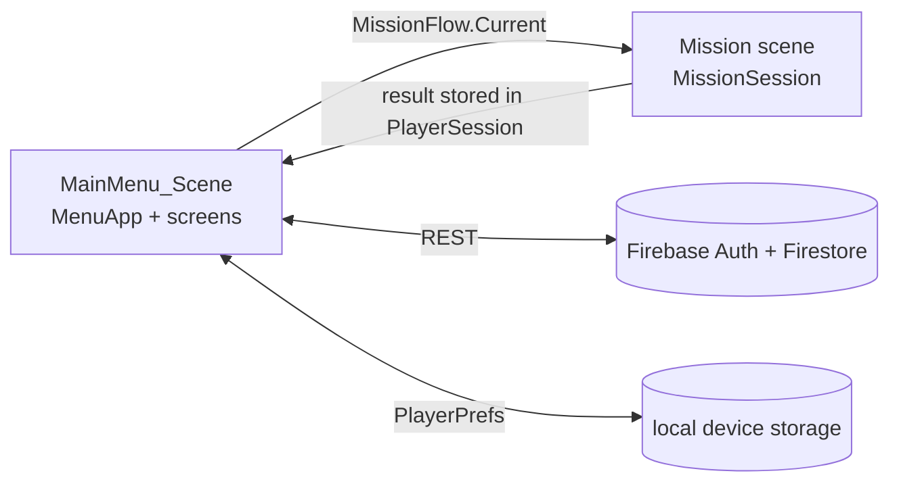

# Firewall Duty: Technical Documentation

This document describes how the Unity project is built, so that a developer can open it, build it and extend it. For the feature list see [SOFTWARE_FEATURES.md](SOFTWARE_FEATURES.md), and for the game flow see [flowchart.html](flowchart.html).

## 1. Overview

| Item | Value |
|------|-------|
| Engine | Unity 6, editor `6000.4.6f1` |
| Platform | Android (portrait and landscape allowed, touch controls) |
| Render pipeline | Universal Render Pipeline 17.4 (`Mobile_RPAsset` and `PC_RPAsset` in `Assets/Settings/`) |
| Input | Input System 1.19 only (`activeInputHandler: 1`); the legacy `UnityEngine.Input` API throws |
| Navigation | AI Navigation 2.0 (baked NavMesh per scene) |
| UI | uGUI and TextMeshPro, built mostly from code |
| Backend | Firebase Authentication and Firestore over the public REST interface (no Firebase SDK) |
| First-party code | about 37,000 lines of C# in `Assets/Scripts/` (including 36 editor scripts) |
| Package id | `com.example.firewall_3d` (kept the same as the earlier Android app) |
| Android | min SDK 25, ARM64 |
| Version | 0.1.0 |

The game has two parts that live in different scenes:
- **Menu** (`MainMenu_Scene`): login, main menu, trivia, rankings, profile, mission selection, briefing, outcome. It is a port of an earlier Android Studio app.
- **Missions** (`Company_scene` = office, `Bank_scene` = bank): the first-person 3D game. Each environment holds 10 missions, which run in the same scene with different data.

Scenes in the build list: `MainMenu_Scene`, `Company_scene`, `Bank_scene`, `SampleScene` (unused sample).

## 2. Setup and build

1. Install Unity `6000.4.6f1` with **Android Build Support** (SDK, NDK, OpenJDK).
2. Open the project from Unity Hub. The first import regenerates `Library/` and takes a while.
3. Optional: create the three config files from the `.example.json` templates (see section 9).
4. Run `Tools > Firewall Duty > Android > Prepare Android Build` (`AndroidBuildSetupTool`), then build from **File > Build Profiles**.
5. To test in the Editor, open `MainMenu_Scene` and press Play.

There are no automated tests. The Test Framework package is installed, but there are no test assemblies and no `.asmdef` files, so all scripts compile into `Assembly-CSharp` (runtime) and `Assembly-CSharp-Editor` (the `Editor/` folder).

## 3. Repository layout

```
Assets/
  Scenes/            MainMenu_Scene, Company_scene, Bank_scene (+ baked NavMesh assets)
  Scripts/           first-party code
    Menu/            menu app, Firebase, session, screens, sounds, UI toolkit
    Menu/Screens/    one class per menu screen
    Mission/         mission session, scenarios, tablet, floor guide, intro, HUD
    Editor/          scene setup tools (Tools > Firewall Duty)
  Plugins/Android/   FirewallBridge.java (Google sign-in and photo picker on a phone)
  Resources/MenuUI/  menu pictures, Android layout XML, trivia_questions.json, config templates
  Settings/          URP assets
  ithappy/, PolygonalMind/, Mnostva Art/, PandazoleHome/, nappin/ ...   third-party asset-store content
docs/                documentation
ProjectSettings/     Unity settings
```

Only `Assets/Scripts/` is first-party code. Everything else under `Assets/` is third-party content.

## 4. Architecture



**Menu to mission handoff.** The Mission Briefing screen stores the chosen mission in `MissionFlow.Current` and loads the environment's scene (`MissionData.SceneName`). `MissionSession` reads it, runs the timer and objectives, and when the mission ends it stores the result and loads the menu scene, which opens the Mission Outcome screen.

**Wiring.** Components in the mission scenes are connected through serialized fields in the scene (not code lookups), so check the scene when behaviour seems unconnected. Mission code finds characters and objects by name when a mission starts, and skips a step whose character or object is missing (with a Console warning), so a mission can always be finished.

## 5. Menu module (`Assets/Scripts/Menu/`)

- **`MenuApp`** lives in the menu scene and shows one screen at a time (`App.Show("Name")`, `App.Back()`). Screens (`MenuScreens` factory) are subclasses of `MenuScreen`, one per old Android Activity: Login, SignUp, ForgotPassword, GameMenu, Continue, OperationsHub, SceneSelection, MissionSelection, MissionBriefing, Loading, Story, MissionOutcome, Profile, Leaderboard, Achievements, Settings, Trivia, Tablet.
- Screens are **built from code** the first time they are shown, using `UiKit`, `UiWidgets`, `MenuStyle` and `UiLayout`.
- **`AndroidLayout`** (about 1,400 lines) reads an Android layout XML from `Resources/MenuUI/Layouts/` and builds it as Unity UI (LinearLayout with weights and gravity, FrameLayout, part of ConstraintLayout, margins, padding). The Cyber Tablet and its six example screens use the original Android layouts this way. `Tools > Firewall Duty > Menu UI > Import Android Assets` copies them in from the Android project.
- **`GameSettings`** stores graphics quality, touch sensitivity and master and effects volume in `PlayerPrefs` and applies them.
- **Trivia:** `TriviaScreen` picks 30 random questions from `Resources/MenuUI/trivia_questions.json`, shuffles answers and awards 5 EXP per correct answer.
- **Sounds:** there are no audio files. `MenuMusic` (menu loop) and `GameSounds` (footsteps, doors, vehicle ride, laptop, chime, typing) generate their audio in code with `AudioClip.Create` the first time they are needed.

## 6. Backend and data

`FirebaseRest` talks to Firebase over HTTPS with `UnityWebRequest`, so no Firebase SDK is needed.

| Function | Endpoint |
|----------|----------|
| Email sign-in, sign-up, password reset, refresh token | Firebase Auth REST |
| Google sign-in | Google ID token exchanged for a Firebase account (`SignInWithGoogle`) |
| Read and update the player | Firestore `players/{uid}` (`GetPlayer`, `SetPlayerFields`) |
| Leaderboard | Firestore `runQuery` on `players`, ordered by `exp` descending (`TopPlayers`) |

**Google sign-in** has two paths: on a phone, `NativeBridge` calls `Plugins/Android/FirewallBridge.java` (the phone's own sign-in sheet); in the Editor, `GoogleDeviceLogin` uses Google's device flow (a code typed at google.com/device). Facebook sign-in code exists (`FacebookLogin`) but is not active in the game.

**Player record** (`PlayerSession.PlayerData`, Firestore `players` collection): `uid`, `fullName`, `username`, `email`, `level`, `exp`, `totalPoints`, `unlockedAchievements`, `photoUri`. Level is `1 + exp / 200` (`ExpPerLevel = 200`).

**Local storage** (`PlayerPrefs`): refresh token (stay signed in), remembered email, per-player mission progress per environment, pending unfinished missions (the Continue screen), and the game settings.

**Progression rules** (`PlayerSession`, `MissionSession`):
- Missions unlock in order, per environment.
- EXP and points are awarded only the first time a mission is finished.
- Achievement certificates (7) are tracked in `unlockedAchievements`: one per threat type plus Trivia Master.

## 7. Mission system (`Assets/Scripts/Mission/`)

### 7.1 Data
- **`MissionData`**: titles and threat types for the 20 missions, the six objectives for each threat, and the story slides.
- **`MissionScenarios`** (about 3,400 lines): each mission is data, a list of steps (`MissionStep`) plus one investigation (`EmailScenario`).

Step kinds (`StepKind`): `Meeting`, `Talk`, `PickUp`, `Deliver`, `Analyze`, `Report`, `Inspect`, `Interview`, `Tablet`.

### 7.2 Detection methods
Every threat's evidence is the three names on the Cyber Tablet. A threat type always reuses its method:

| Threat | Method | Code |
|--------|--------|------|
| Phishing (bank) | Compare the email with the bank's real notice and tap the 3 differences | `EmailInvestigationUI` (Compare) |
| Malware | Inspect places and machines in the scene | `InspectionOverlay`, `Inspect` step |
| Social Engineering | Interview a character | `InterviewOverlay`, `Interview` step |
| Unauthorized Access | Live login monitor; BLOCK records in time | `EmailInvestigationUI` (Live) |
| Spam | Filter switches that empty a flooded inbox | `EmailInvestigationUI` (Filter) |
| Office missions | Document lines, cards board, table, chat bubbles | `EmailInvestigationUI` |

### 7.3 Session, timer and scoring (`MissionSession`)
- Six objectives per mission. The timer is **360 s** (`timeLimitSeconds`) and starts only after the player times in (`MissionIntro`).
- **+10 EXP** per completed objective and **+10** bonus for the final one. **-10 EXP and points** for each wrong response in the last objective (each wrong option counts once).
- A harmless wrong tap costs time (`wrongTapPenalty`, 5 s). The timer reaching zero ends the mission as a timeout.
- Other scripts only call `CompleteObjective(index)` and `EndMission()`.

### 7.4 Scenario controller
`MissionScenarioController` is added automatically to the `MissionSession` object. It runs the steps, makes characters and objects interactable, sets up the teller area in the bank, and drives the on-screen hint and marker.

### 7.5 Guidance arrow (`FloorGuide`, `MissionMarker`)
A trail of arrows on the floor leads to the current target. It follows the **baked NavMesh** (`NavMesh.CalculatePath`), and where there is no NavMesh (the street) it is a straight line. Closed areas that are not on the NavMesh (the bank's teller area and manager's room) are registered as *pockets* with an outside door and an inside door, so the route goes through the door and not through walls.

### 7.6 Arrival (`MissionIntro`)
Each mission starts with a ride (taxi in clear weather, bus in rain, taxi in snow; the pattern repeats every three missions), then the player enters and times in at the receptionist (office) or the first teller (bank).

### 7.7 Cyber Tablet
`TabletView` builds the tablet from the Android layouts (`activity_tablet` and the six threat screens). It is used in the menu and, through `TabletOverlay`, during missions (the timer keeps running).

## 8. Player, interaction and characters

- **Movement:** `PlayerMobileController` (needs a `CharacterController`) reads `VirtualJoystick.Direction` each frame, applies gravity manually, and plays footsteps. `ApplyLookDelta` yaws the player and pitches the camera (clamped).
- **Input (UI-driven):** `VirtualJoystick` and `TouchLookArea` are uGUI pointer handlers, not Input System actions. The joystick is **floating**: it appears where the thumb touches the left half of the screen (`JoystickZone`) and returns to its corner on release.
- **Interaction:** `PlayerInteraction` picks a target every frame: first a crosshair raycast, then the nearest `Interactable` in its own range with line of sight. Targets have a `Priority` so that, for example, a computer next to a person can be selected. The on-screen hand button calls `Interact()`; `InteractionPromptUI` shows its label.
- **Interactables:** subclass `Interactable` and override `Interact()`. Included: `DoorInteractable` (hinge pivot, swing away from the player), `SlidingDoorInteractable`, `SeatInteractable`.
- **NPCs:** `NpcWorker` (sit at a computer or stand at a machine), `NpcWalker`, `NpcGestures`, `NpcHeadBehaviour` (look at the player), `NpcCoffeeDrinker`, `NpcAtmUser`, `NpcLapTapper`, `Pedestrian` (street walkers, straight line).
- **Pause menu:** `PauseMenu` (Resume, Settings, Quit with confirmation). Quitting keeps the mission as the Continue entry, and it restarts from the beginning.

## 9. Configuration and security

Three config files are read from `Assets/Resources/MenuUI/` and are **not in the repository**. Templates are provided:

| File | Contents |
|------|----------|
| `firebase_config.json` | `projectId`, `apiKey`, `webClientId` |
| `google_device_config.json` | Google OAuth `clientId`, `clientSecret` (client type "TVs and Limited Input devices") |
| `facebook_config.json` | `appId`, `clientToken` (the Facebook App Secret must never be in the game) |

Security notes for reviewers:
- Files under `Resources/` are packed into the APK, so a distributed APK exposes these values. Google does not treat an installed-app OAuth secret as confidential, but the APK should not be shared publicly while it contains it.
- Because the game uses Firebase's public REST API from the client, **all protection comes from the Firestore security rules**, not from the app. The rules should allow each user to write only their own `players/{uid}` document and read the fields needed for the leaderboard. The rules are not part of this repository and should be reviewed in the Firebase console.
- Passwords are never stored; only the Firebase refresh token is kept locally.

## 10. Editor tools

Scene setup was done with editor tools under `Tools > Firewall Duty` (36 scripts in `Assets/Scripts/Editor/`). The main ones:
- `Set Up Mission System`, `Set Up Doors In Open Scenes` (idempotent), `Set Up Hand Interaction Button In Open Scenes`
- `Android > Prepare Android Build`, `Menu UI > Import Android Assets`, `Menu UI > Create Menu Scene`
- `NPC > ...` (cubicle workers, IT experts, receptionist, meeting room, walking, NavMesh rebake)
- `Office > ...` and `Bank > ...` (environment decoration, entrance street, counters)
- `Run Door Self-Test`

Testing helpers: `Testing > Toggle Debug Buttons` shows hidden debug buttons (for example DEBUG FINISH), and `Testing > Toggle Unlock All Missions` unlocks every mission. Both are off by default (`DevelopmentOnly`).

## 11. How to add a mission

1. Add the title and threat to `MissionData` (`OfficeTitles`/`OfficeThreats` or the bank arrays).
2. Add a case to `MissionScenarios` (the `switch` that returns a scenario for the mission number) with its steps and an `EmailScenario`.
3. Use the detection method that matches the threat type (section 7.2), and make the three evidence names match the Cyber Tablet.
4. Make sure the characters and objects the steps name exist in the scene.

## 12. Known limitations

- Facebook sign-in is not active.
- The project has no automated tests. The scripts were compile-checked outside Unity, and behaviour is verified by playing in the Editor and on a device.
- The floor-arrow routing in closed areas depends on the wall layout of each scene. A wrong arrow in one room is fixed by registering that room as a pocket in `MissionScenarioController.SetUpTellerArea` (or equivalent).
- Only `SampleScene` is an unused leftover in the build list.
- Third-party asset-store content is included as it came and is subject to its own licences.
